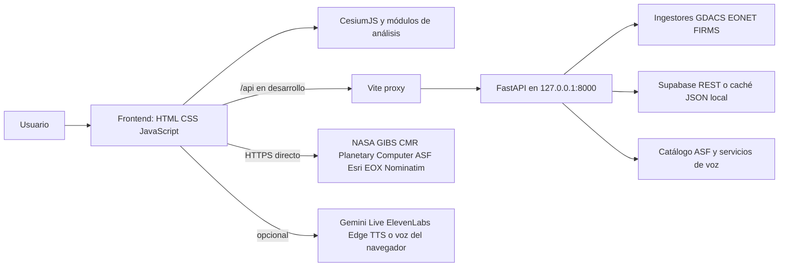

# Arquitectura de TerraPulse

Documento técnico del estado actual del código. Describe cómo se ejecuta la aplicación, qué servicios consulta, qué librerías utiliza y qué API expone. Algunas fuentes o módulos están integrados parcialmente; se indican sus limitaciones para no confundir una capacidad planeada con una conexión activa.

## 1. Resumen

TerraPulse es una aplicación web geoespacial. El frontend presenta un globo 3D, capas satelitales, eventos y herramientas de comparación. El backend local, escrito en Python, ofrece una API para eventos, consultas SAR, teselas, proyecciones y voz.

El procesamiento de las zonas dibujadas ocurre principalmente en el navegador. El frontend consulta directamente varios servicios públicos de observación de la Tierra; no todas las imágenes atraviesan el backend.

## 2. Componentes y arranque

### Frontend

- `index.html` define la página y carga CesiumJS, jsPDF, estilos y módulos JavaScript.
- `src/main.js` coordina la aplicación: eventos, búsqueda, mapa, módulos, comparador y llamadas al backend.
- `src/map.js` controla Cesium, las capas, los polígonos y las entidades visuales.
- Otros módulos de `src/` se encargan de alertas, análisis, fuentes satelitales, animaciones, zonas, reportes y asistente de voz.

### Backend

- `backend/main.py` crea la aplicación FastAPI, registra endpoints y tareas periódicas.
- `backend/ingestors.py` obtiene y normaliza algunos eventos externos.
- `backend/database.py` persiste y consulta esos eventos.
- `backend/sar_engine.py`, `backend/timemachine.py` y `backend/predictor.py` implementan servicios especializados.
- `backend/tiles.py` ofrece un proxy con caché para teselas.
- `backend/voice.py` proporciona configuración y servicios de voz.

### Desarrollo y despliegue

- `npm run setup` crea `backend/.venv` e instala las dependencias Python de `backend/requirements.txt`.
- `npm run dev` ejecuta `scripts/dev.mjs`: intenta iniciar Uvicorn en `127.0.0.1:8000` y Vite en `localhost:5173`.
- `vite.config.js` reenvía `/api` al backend durante desarrollo y preview.
- `npm run build` construye los archivos estáticos del frontend.
- GitHub Pages sirve archivos estáticos y no ejecuta FastAPI. `src/connection.js` detecta ese escenario y cambia a modo offline; las funciones que dependen del backend no estarán disponibles allí.

## 3. Conexiones de datos

### Servicios consultados por el backend

| Servicio | Uso | Condición o estado |
|---|---|---|
| GDACS | Alertas internacionales de desastres | Se consulta desde `backend/ingestors.py`. |
| NASA EONET | Catálogo de eventos naturales | Se consulta desde `backend/ingestors.py`. |
| NASA FIRMS | Focos térmicos VIIRS | Requiere `NASA_FIRMS_KEY` o `FIRMS_MAP_KEY`. Sin clave, el ingestor devuelve una lista vacía. |
| ASF DAAC | Búsqueda de escenas NISAR, Sentinel-1 y ALOS | El endpoint SAR del backend usa `asf_search`. |
| Supabase REST | Lectura y escritura de eventos en `disaster_events` | Requiere `SUPABASE_URL` y `SUPABASE_SERVICE_KEY`; las llamadas se hacen desde Python. |
| Gemini | Creación de token temporal para Live API | Requiere `GEMINI_API_KEY`; la clave permanece en el backend. |
| ElevenLabs | Síntesis y reconocimiento de voz | Las llamadas requieren `ELEVENLABS_API_KEY`; son funciones opcionales. |
| ITS_LIVE | Se anuncian registros de monitoreo de glaciares | En el código actual no hay consulta remota: se crean tres registros para ubicaciones predefinidas. |

### Servicios consultados directamente por el frontend

| Servicio | Uso |
|---|---|
| NASA GIBS / WMTS | Teselas satelitales y ambientales de MODIS, VIIRS, SMAP, GOES, HLS, OPERA y productos históricos. |
| Microsoft Planetary Computer | Catálogo STAC y estadísticas de Sentinel-2 y Landsat para índices y temperatura superficial. |
| NASA CMR | Búsqueda de escenas HLS de Landsat/Sentinel-2 por fecha y cobertura de nubes. |
| ASF DAAC | El módulo de zonas consulta escenas NISAR y descarga imágenes de vista previa directamente. |
| Esri World Imagery / Wayback | Fondo cartográfico y versiones históricas de imágenes. |
| EOX Sentinel-2 Cloudless | Mosaicos anuales sin nubes y respaldo visual. |
| OpenStreetMap Nominatim | Búsqueda y geocodificación de lugares. |
| Google Maps | Enlaces externos para abrir o compartir una ubicación. |

### Proxy de teselas

`backend/tiles.py` implementa rutas para teselas base y GIBS con caché en disco. Sin embargo, las funciones actuales `baseTileUrl()` y `gibsTemplate()` en `src/connection.js` generan URLs públicas directas. `viaApi()` también devuelve la URL sin modificarla. Por eso, la existencia del proxy no significa que todas las teselas actuales pasen por FastAPI.

## 4. Librerías y APIs del navegador

| Tecnología | Función |
|---|---|
| Vite | Servidor de desarrollo, proxy `/api` y compilación del frontend. Es la única dependencia npm directa declarada. |
| CesiumJS | Globo 3D y visualización geoespacial; se carga desde CDN en `index.html`. |
| jsPDF | Generación de reportes PDF en el navegador; se carga desde CDN. |
| Fetch, WebSocket, Canvas, Web Audio, MediaDevices y localStorage | APIs nativas del navegador para consultas HTTP, voz en tiempo real, procesamiento de audio e imágenes y preferencias locales. |
| Web Speech API | Reconocimiento/síntesis de voz de respaldo, sujeto al soporte del navegador. |

El frontend usa módulos JavaScript propios; no declara React, Leaflet ni Mapbox como dependencias npm.

## 5. Librerías Python

| Paquete | Función en el proyecto |
|---|---|
| `fastapi` | Definición de la API REST. |
| `uvicorn` | Servidor ASGI que ejecuta FastAPI. |
| `apscheduler` | Sincronizaciones periódicas al iniciar el backend. |
| `httpx` | Solicitudes HTTP, incluidas las asíncronas. |
| `requests` | Solicitudes HTTP síncronas a Supabase REST. |
| `python-dotenv` | Lectura de variables de entorno desde `.env`. |
| `psycopg2-binary` | Driver PostgreSQL. Existe `get_db_connection()` para `DATABASE_URL`, pero el flujo de eventos actual usa Supabase REST o caché JSON local. |
| `asf_search` | Consulta del catálogo de escenas SAR de ASF desde el backend. |
| `earthengine-api` | Google Earth Engine para el endpoint `/historical-compare`; necesita autenticación de Earth Engine. |
| `edge-tts` | Voz neuronal de Edge TTS sin clave; el backend la usa como motor TTS predeterminado o respaldo. |

FastAPI incorpora Pydantic como dependencia para validar algunos datos de entrada; el proyecto lo usa en la petición de texto del endpoint TTS.

## 6. API propia

La documentación interactiva de FastAPI está disponible, con el backend activo, en `http://127.0.0.1:8000/docs`; el esquema se publica en `/openapi.json`.

| Método y ruta | Función |
|---|---|
| `GET /api/v1/health` | Estado y hora del backend. |
| `POST /api/v1/sync-test` | Ejecuta manualmente los ingestors y guarda eventos. |
| `GET /api/v1/disasters` | Devuelve un `FeatureCollection` GeoJSON. Admite filtros por tipo, severidad, coordenadas y radio. |
| `GET /api/v1/historical-compare` | Solicita teselas de Sentinel-1 y Landsat mediante Earth Engine para dos fechas. Requiere autenticación; no es el comparador principal usado por el frontend actual. |
| `GET /api/v1/sar-analysis` | Busca huellas y vistas previas SAR en ASF con `asf_search`. |
| `GET /api/v1/timemachine` | Construye URLs GIBS para comparar fechas y devuelve metadatos de capas. |
| `GET /api/v1/predict-risk` | Devuelve un puntaje paramétrico, una curva, polígonos GeoJSON y una recomendación de producto NISAR. No es un modelo entrenado y validado. |
| `GET /api/v1/tiles/base/{z}/{x}/{y}` | Proxy/cache para imágenes del mapa base. |
| `GET /api/v1/gibs/{layer}/{time}/{tms}/{z}/{y}/{x}.{ext}` | Proxy/cache para una tesela NASA GIBS. |
| `GET /api/v1/voice/config` | Informa si están disponibles Gemini, ElevenLabs y TTS. |
| `POST /api/v1/voice/token` | Solicita un token temporal para Gemini Live. Solo se entrega a clientes locales. |
| `POST /api/v1/voice/tts` | Genera audio. Prioriza ElevenLabs si está configurado y usa Edge TTS como respaldo. |
| `POST /api/v1/voice/stt` | Envía audio a ElevenLabs para transcribirlo; necesita clave. |

Las llamadas principales a estos endpoints están agrupadas en `src/api.js`. El proxy de teselas y los endpoints de voz se consumen por separado.

## 7. Flujo de análisis de una zona

1. El usuario busca una ubicación, elige un radio o dibuja un polígono en el mapa.
2. `src/zones.js` calcula el área y mantiene la selección en memoria. El área permitida para análisis es de hasta 1,500 km².
3. Para vegetación, humedad, suelo e incendios, `src/vegetation.js` consulta Sentinel-2 en Planetary Computer y calcula NDVI, EVI, SAVI, NDMI, NBR, NDWI y BSI.
4. Para temperatura superficial, busca escenas Landsat y calcula una estimación a partir de la banda térmica.
5. Para anomalías, compara observaciones despejadas con años anteriores en una época similar y divide la zona en sectores.
6. Para NISAR, `src/nisar.js` consulta ASF directamente y calcula cambios relativos a partir del brillo de imágenes de vista previa.
7. Los resultados se visualizan en el mapa y se interpretan en los paneles o mediante Terra.

## 8. Eventos, almacenamiento y tareas

Al iniciar, APScheduler programa sincronizaciones: GDACS, EONET y FIRMS cada 15 minutos; los registros etiquetados como ITS_LIVE cada 12 horas. Las tareas se ejecutan inmediatamente una vez al arrancar.

`backend/database.py` guarda eventos en `backend/.events_cache.json`. Si Supabase está configurado, intenta escribirlos y leerlos también mediante REST. Si falla la escritura REST, conserva los datos en caché local. Aunque hay una función para abrir PostgreSQL con `DATABASE_URL`, no es la ruta principal de persistencia utilizada por estas operaciones.

## 9. Asistente de voz

Terra tiene dos caminos principales:

- **Gemini Live:** el backend obtiene un token temporal. El navegador usa WebSocket para intercambiar audio y texto, y envía comandos limitados a herramientas explícitas de `src/assistant/tools.js`.
- **Modo local:** `src/assistant/local.js` interpreta frases con reglas y utiliza las capacidades de voz del navegador. Si se configura ElevenLabs, hay servicios de voz y transcripción en el backend; para TTS, `edge-tts` puede funcionar sin clave y como respaldo.

Las acciones sensibles definidas por las herramientas, como borrar zonas, sincronizar fuentes, compartir una ubicación o enviar un formulario, piden confirmación.

## 10. Configuración opcional

Las claves y credenciales deben permanecer en `backend/.env`, nunca en el JavaScript público del frontend.

| Variable | Uso |
|---|---|
| `SUPABASE_URL` | URL del proyecto Supabase. |
| `SUPABASE_SERVICE_KEY` | Acceso del backend a la API REST de Supabase. Debe mantenerse secreta. |
| `DATABASE_URL` | Cadena PostgreSQL usada por la función de conexión directa disponible. |
| `NASA_FIRMS_KEY` o `FIRMS_MAP_KEY` | Acceso al servicio de área de NASA FIRMS. |
| `GEMINI_API_KEY` | Creación de tokens de Gemini Live. |
| `GEMINI_LIVE_MODEL` | Modelo Live; tiene un valor predeterminado en el código. |
| `ELEVENLABS_API_KEY` | TTS/STT de ElevenLabs. |
| `ELEVENLABS_VOICE_ID`, `ELEVENLABS_TTS_MODEL`, `ELEVENLABS_STT_MODEL` | Personalización de voz y modelos de ElevenLabs. |
| `TERRA_VOICE`, `TERRA_VOICE_RATE` | Voz y velocidad de Edge TTS. |

Earth Engine también requiere que el entorno Python esté autenticado. Configurar `earthengine-api` por sí solo no proporciona esas credenciales.

## 11. Limitaciones que deben tenerse en cuenta

- El frontend estático de GitHub Pages no ejecuta la API local; los endpoints FastAPI requieren el backend activo.
- Los análisis de índices y temperatura dependen de escenas disponibles, cobertura de nubes y conectividad con Planetary Computer.
- El cambio de NISAR se estima con imágenes de vista previa y no equivale a una medición radar calibrada.
- El puntaje de `/predict-risk` se calcula con reglas paramétricas y eventos cercanos; no debe interpretarse como pronóstico validado.
- FIRMS depende de una clave. ITS_LIVE está simulado mediante ubicaciones fijas en el ingestor actual.
- El endpoint histórico de Earth Engine requiere autenticación y no sustituye al flujo GIBS que utiliza el comparador del frontend.
- Una anomalía, un foco térmico o una variación radar no confirma por sí sola un incendio u otro evento ambiental.

## 12. Archivos clave

- `index.html`: estructura de la interfaz y carga de CDN.
- `src/main.js`: coordinación de la aplicación.
- `src/map.js`: globo y capas Cesium.
- `src/api.js`: cliente de la API local.
- `src/connection.js`: detección de conexión y URLs de teselas.
- `src/satelliteSources.js`: catálogo de capas y fuentes.
- `src/vegetation.js`, `src/zones.js`, `src/nisar.js`: análisis de zonas.
- `src/assistant/`: lógica local, herramientas y audio de Terra.
- `backend/main.py`: API y tareas programadas.
- `backend/ingestors.py`, `backend/database.py`: ingestión y almacenamiento de eventos.
- `backend/sar_engine.py`, `backend/timemachine.py`, `backend/predictor.py`: funciones de análisis del backend.
- `backend/tiles.py`, `backend/voice.py`: servicios de teselas y voz.
- `package.json`, `vite.config.js`, `backend/requirements.txt`: dependencias y ejecución.
